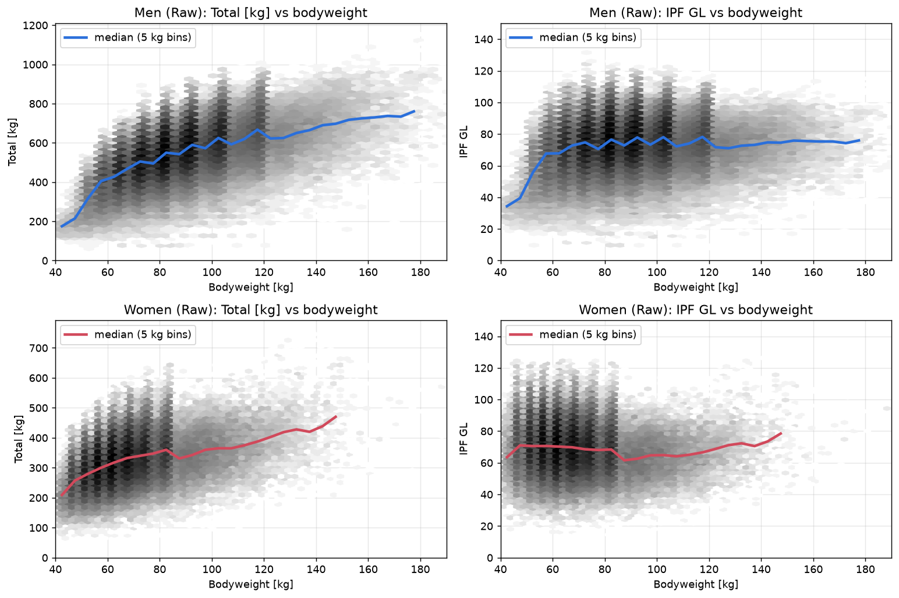
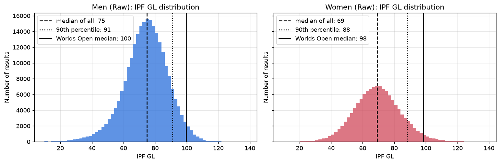
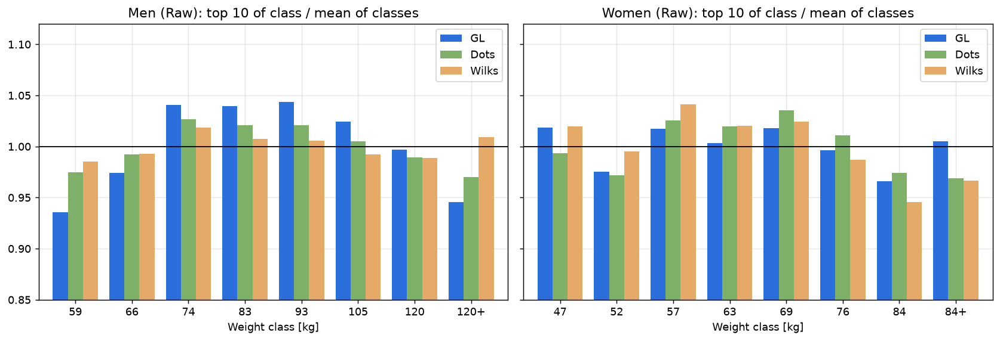
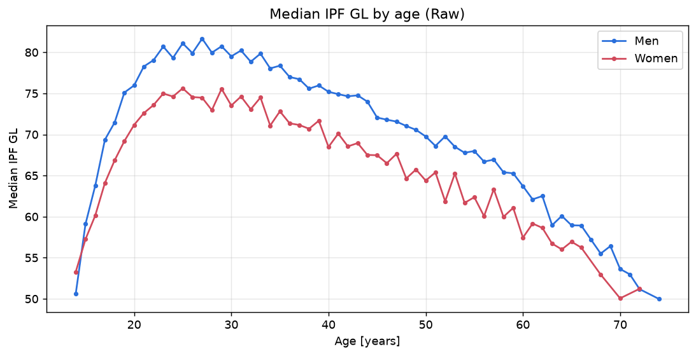
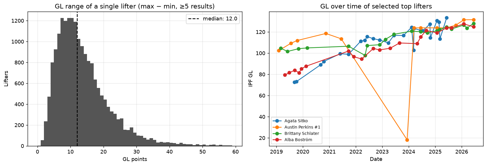
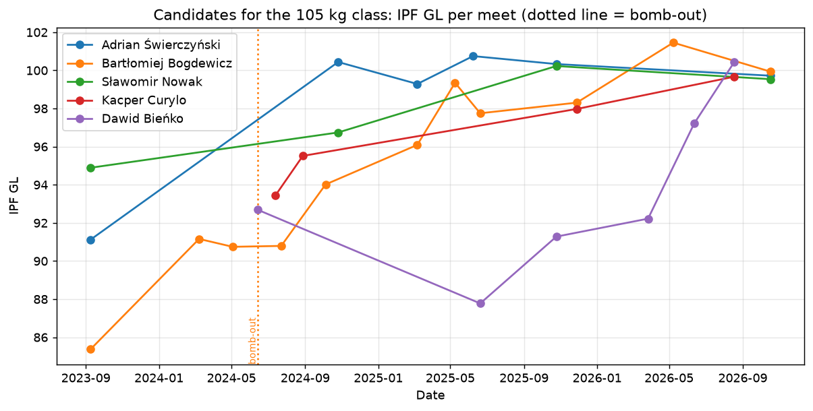

# Powerlifting relative strength: IPF GL Points

English version · [Wersja polska](README.pl.md)

How do you compare a 59 kg lifter with a 120 kg lifter? This repository looks at IPF GL Points, the official
relative-strength metric in powerlifting, using 408k real competition results. It covers what the metric measures,
how to read it, where it is useful, and why a single number is not enough to say who the better lifter is.

Written for the course *Sports Data Analysis*, assignment 2.1: *Sports metrics – from data to decisions*.

Powerlifting has three lifts: squat, bench press and deadlift. Each lifter gets three attempts per lift, and the
result is the Total, the sum of the best successful attempts. Because lifters compete in weight classes, the sport
needs a way to name the best lifter across all classes, and that is what the metric is for.

All numbers below come from the notebook [`analysis.ipynb`](analysis.ipynb): 408k full-power results from
IPF-affiliated federations, 2019-2026 (OpenIPF dataset, snapshot of 24 Oct 2026).

## 1. Name and meaning

IPF GL Points (*IPF Goodlift Points*) is the official formula of the International Powerlifting Federation (IPF),
in force since 1 May 2020. It replaced the Wilks formula and IPF Points used before.

The metric measures relative strength: how a lifter's total compares with the total expected from someone of the
same bodyweight and sex. It is expressed as a percentage of the IPF World Championships level:

$$
\mathrm{GL} = \frac{100 \cdot \mathrm{Total}}{A - B \cdot e^{-C \cdot \mathrm{BW}}}
$$

The denominator is the expected total of a lifter with bodyweight BW at the World Championships. GL = 100 means a
result at the level of a typical World Championships competitor, and GL = 80 is 80% of that level.

In the example below (notebook section 2), ranking by kilograms gives the reverse order of ranking by GL.

| Lifter | Bodyweight | Total | GL | Rank by Total | Rank by GL |
|---|---|---|---|---|---|
| Lifter A (F) | 57 kg | 420 kg | 98.5 | 3 | **1** |
| Lifter B (M) | 66 kg | 600 kg | 93.5 | 2 | 3 |
| Lifter C (M) | 120 kg | 820 kg | 95.3 | **1** | 2 |

## 2. Input data

| Input | Source | Notes |
|---|---|---|
| Total [kg] | meet results | sum of the best successful attempts in all 3 lifts; a lifter who fails all attempts in one lift has no total |
| Bodyweight [kg] | official weigh-in before the meet | the exact bodyweight, not the weight class |
| Sex | entry | separate coefficients for women and men |
| Equipment | entry | *Raw / Classic* (no supportive gear) or *Equipped* (supportive suits) |
| Event | entry | full power or bench only, each with its own coefficients |
| Coefficients A, B, C | IPF rules | 8 sets, fitted by the IPF on World Championships results |

Coefficients for full power:

| Sex, equipment | A | B | C |
|---|---|---|---|
| Men, Raw | 1199.72839 | 1025.18162 | 0.00921 |
| Women, Raw | 610.32796 | 1045.59282 | 0.03048 |
| Men, Equipped | 1236.25115 | 1449.21864 | 0.01644 |
| Women, Equipped | 758.63878 | 949.31382 | 0.02435 |

The implementation is in [`powerlifting_metrics.py`](powerlifting_metrics.py). I checked it on the whole dataset
against the `Goodlift` column, which OpenPowerlifting computes independently. The largest difference is 0.005,
which is rounding.

## 3. Interpretation

The normalisation does its job. The Spearman correlation between bodyweight and the result drops from +0.56 for the
Total to +0.15 for GL in men, and from +0.40 to -0.09 in women, so heavier lifters no longer score higher just
for being heavier.



The reference point of 100 does not say whether 75 is a lot or a little. Percentiles do. These are for Raw
results since 2019:

| GL value | Men: share of results below | Women: share of results below | How to read it |
|---|---|---|---|
| < 60 | 13.7% | 25.8% | beginner / very weak meet |
| < 70 | 35.5% | 52.4% | women's median ≈ 69 |
| < 80 | 66.0% | 77.5% | men's median ≈ 75; 80 is a solid national level |
| < 90 | 88.6% | 91.9% | ≥ 90: top 10%, national elite |
| < 100 | 97.6% | 97.8% | ≈ 100: median of the Open division at IPF Worlds (M 99.6; W 98.5) |
| < 110 | 99.7% | 99.5% | ≥ 110: world elite (record in the data: 131.5) |

A high GL means the lifter is strong for their bodyweight, close to or above what a World Championships competitor
of the same weight is expected to total. A low GL can mean inexperience, but it can also come from a bad meet, an
injury or a "practice" meet (see section 5). GL is a ratio scale, where 10 points are 10% of the World
Championships level, so differences between lifters read as percentages without converting kilograms.



## 4. Practical use

| Who | Situation | How GL helps |
|---|---|---|
| Referees / organisers | picking the *Best Lifter* of a meet | one comparison instead of eight weight classes; the IPF uses GL for exactly this |
| National team coach / federation | World Championships selection, scholarships, picking team members when places are limited | comparing candidates from different weight classes |
| Coach and lifter | deciding whether to change weight class (cut 3 kg to the class below or move up) | compute the total needed for the same GL at the new bodyweight and judge whether the move pays off |
| Lifter | tracking progress while bodyweight changes | a higher total at a higher bodyweight is not always progress; GL shows whether it is |
| Analyst | comparisons across years, countries, clubs | one scale for the whole population (e.g. "how many of our lifters have GL > 90?") |

The men's GL leader, Austin Perkins (891.5 kg at 73.3 kg bodyweight, GL 131.5), ranks only 217th by raw Total.
None of the top 10 men by GL is in the top 10 by Total.

## 5. Limitations: why the value alone is not enough

I checked each limitation below on the data (sections 2 and 6 of the notebook).

### a) The formula only works in the range it was fitted on

The coefficients were fitted to results of adult lifters at World Championships. For women the denominator drops
to zero at 17.7 kg bodyweight, and the dataset contains a result of a 7-year-old girl weighing 18 kg whose
117.5 kg total gives GL = 1304. For men it goes the other way: the formula penalises very light lifters.

### b) Weight classes are not perfectly levelled

Among men, the mean GL of the 10 best lifters is 107.4 in the 59 kg class and 119.8 in the 93 kg class. The
lightest and heaviest (120+) classes sit 5-6% below the average and the 74-93 kg classes 4% above it. In this test
the older Wilks formula is more even for men (spread 1.2% against 4.4% for GL), while for women GL is the most
even of the three (2.0%). Class size explains part of the gap: 29k lifters competed at 83 kg and 4.4k at 59 kg,
and a top 10 drawn from a bigger pool is stronger. Whether a metric counts as "fair" therefore depends on how you
measure fairness.



### c) The metric ignores age

Median GL peaks at age 25-27 (M 81.7; W 75.6). It is 9-10 points lower at 18 and 18 points lower at 60. A junior
with GL 85 may have more potential than a 28-year-old with GL 90, and GL alone will not show that.



### d) Equipment still matters

GL has separate coefficients for equipped lifting, which in theory makes results comparable. Yet the 8.5k lifters
who competed in both categories have a median GL 6.4 points lower equipped than raw, with a wide spread (from -18
to +6 for 80% of them).

### e) One meet is not the whole story

For lifters with at least 5 results, the median gap between their best and worst GL is 12 points, and for one in
ten it exceeds 24. Form, weight cuts, missed attempts and the purpose of the meet all affect the result. The
ranking leader has a December 2023 result with a 125 kg total (25 / 25 / 75 kg, GL ≈ 18), a token total about a
seventh of the lifter's best, and the metric scores it like any other meet.



### f) One number hides the lifter's profile

GL only looks at the total. Among the top 10 men, the squat makes up 33% to 38% of the total and the deadlift
37.5% to 42%. A coach planning training or attempt selection needs that split, and GL does not carry it.

### g) Data quality

The same result sometimes appears several times (a lifter entered as a junior and in the Open division at the
same meet), and the dataset includes results of children. Without cleaning, medians and result counts come out
wrong: before I removed duplicates, one of the top lifters dropped from 2nd to 203rd in the median ranking.

### h) The choice of formula changes the top of the ranking

GL, DOTS and Wilks correlate almost perfectly (Spearman 0.99), yet their top 10 lists overlap only 60-90%. The
disagreement sits at the top, where medals and team places are decided.

## Final question: can a single metric decide unambiguously which lifter is better?

No. A single metric orders results by one criterion chosen in advance, and three things stop that ordering from
settling who the better lifter is.

First, the number depends on choices made before computing it: the formula (GL, DOTS, Wilks or the raw Total), the
aggregation (peak, median, latest result) and the scope of the data (period, federation, equipment). Each choice
changes the ranking. The top 10 by Total and the top 10 by GL share no lifters at all.

Second, the same metric can point to different lifters. An example from the data (notebook section 7):

| Lifter | Meets | Best GL | Rank | Median GL | Rank |
|---|---|---|---|---|---|
| Ade Omisakin | 18 | **122.5** | **5** | 109.3 | 55 |
| Russel Orhii | 10 | 120.9 | 13 | **117.0** | **3** |

By peak result Omisakin is better, and by typical result Orhii is. They met twice, at the 2021 World Championships
(GL 116.7 vs 103.9) and in Sheffield 2025 (120.6 vs 118.0), and Orhii won both times. A coach who needs someone
capable of a career-best day would pick Omisakin; a coach who needs a reliably high result on the day would pick
Orhii.

Third, a metric measures only what goes into it. GL does not account for age, development potential, consistency,
lift profile, injury history or the purpose of a meet, and it has the biases described in section 5: uneven weight
classes, a limited valid range and dependence on equipment.

A metric like IPF GL is a good tool for narrowing down choices and comparing results objectively under fixed
conditions, which is how the IPF uses it. Assessing a lifter properly still takes several metrics (peak,
consistency, trend, age), the context of each meet and a coach's judgement.

## Second analysis: picking a lifter for the World Championships

Assignment 2.2 (*From an idea to an analysis*) puts that conclusion to work. The Polish federation has one place
in the men's 105 kg class at the IPF World Classic Championships, and five active Polish lifters have a best GL
between 99.7 and 101.5. The notebook [`team_selection.ipynb`](team_selection.ipynb) compares them with four
metrics, using real Polish results since 2023 including individual attempts and bomb-outs.

| Lifter | Peak GL | Form GL (median of last 3) | Attempt success | Trend GL/year |
|---|---|---|---|---|
| Adrian Świerczyński | 100.7 | **100.3** | 62.3% | 2.6 |
| Bartłomiej Bogdewicz | **101.5** | 99.9 | 74.8% | **4.9** |
| Sławomir Nowak | 100.2 | 99.5 | **83.3%** | 1.7 |
| Kacper Curylo | 99.7 | 98.0 | **83.3%** | 2.6 |
| Dawid Bieńko | 100.4 | 97.2 | 75.0% | 3.3 |

Each metric has a different leader. Świerczyński has the best current form but makes only 62% of attempts
against a Polish average of 74%; Bogdewicz has the highest peak and the steepest improvement; Nowak and Curylo
are the most reliable. With the top three within 0.8 GL of each other in form, the recommendation is Bogdewicz,
with Świerczyński as the reserve and a more conservative bench press opener for Bogdewicz, who missed it in 4 of
12 meets. The full write-up in Polish, with its limitations, is
[`report/Zadanie_2.2_wybor_kadry.pdf`](report/Zadanie_2.2_wybor_kadry.pdf).



## Repository structure

```
├── README.md                     ← write-up in English (this file)
├── README.pl.md                  ← write-up in Polish
├── analysis.ipynb                ← first analysis: IPF GL and its limitations
├── team_selection.ipynb          ← second analysis: picking a lifter for the World Championships
├── powerlifting_metrics.py       ← IPF GL implementation, attempt counts, data loading
├── pyproject.toml, uv.lock       ← dependencies (managed with uv)
├── scripts/make_sample.py        ← builds the worldwide sample (SBD results since 2024)
├── scripts/make_poland_sample.py ← builds the Polish sample (Raw starts since 2023, with attempts)
├── data/sample/                  ← both samples (6.7 MB and 1.1 MB)
├── data/raw/                     ← full dataset (downloaded automatically, not in git)
├── figures/                      ← charts used in the write-ups
└── report/                       ← PDF write-ups for the course (Polish) and their sources
```

## How to run

The project uses [uv](https://docs.astral.sh/uv/):

```bash
uv sync
uv run jupyter notebook analysis.ipynb
```

With `USE_SAMPLE = False` (the default), the notebook downloads the full OpenIPF dataset (~70 MB) into `data/raw/`
on first run. The numbers in this write-up come from this mode. With `USE_SAMPLE = True` it uses the sample bundled
with the repository and works offline; the numbers differ slightly because the sample covers only 2024-2026.

`team_selection.ipynb` opens the same way. It reads the bundled Polish sample by default (`USE_SAMPLE = True`),
which already contains everything the analysis needs.

## Sources

- OpenPowerlifting / OpenIPF: data (public domain), https://www.openpowerlifting.org/, https://www.openipf.org/
- Formula and column definitions: OpenPowerlifting data distribution README, https://gitlab.com/openpowerlifting/opl-data/-/blob/main/docs/data-readme.md
- Reference implementation of the GL coefficients: https://gitlab.com/openpowerlifting/opl-data/-/blob/main/crates/coefficients/src/goodlift.rs
- International Powerlifting Federation: technical rules and the IPF GL Points formula, https://www.powerlifting.sport/
