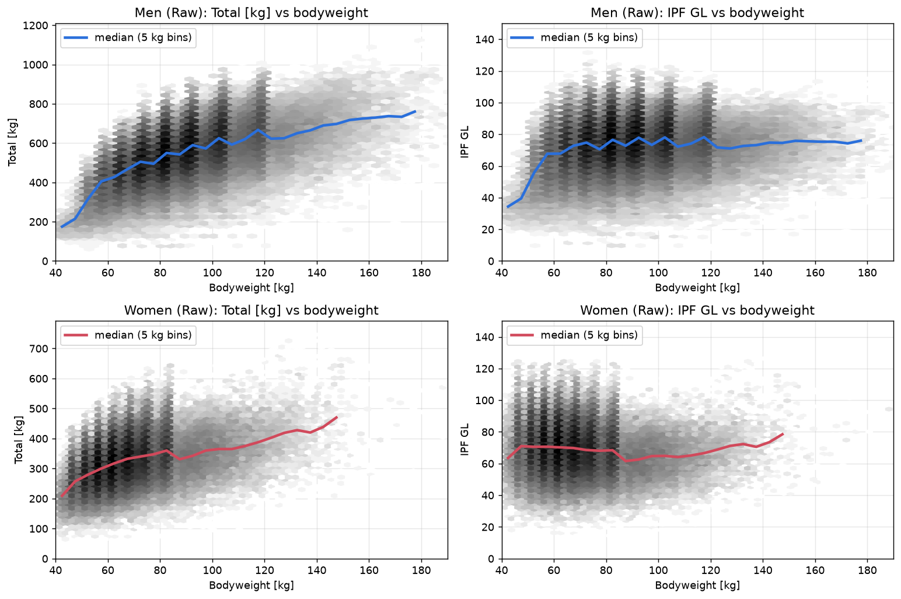
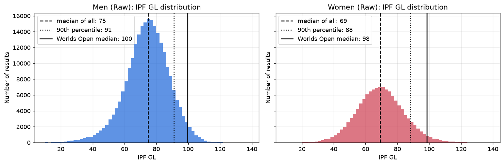
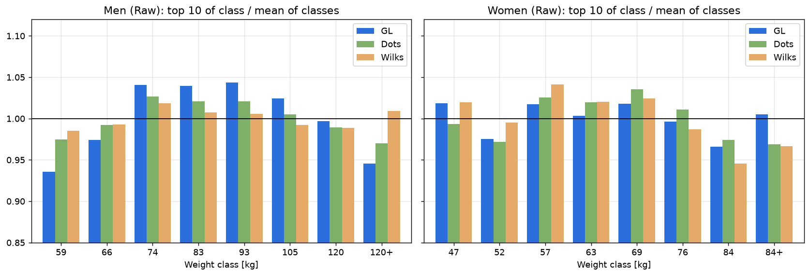
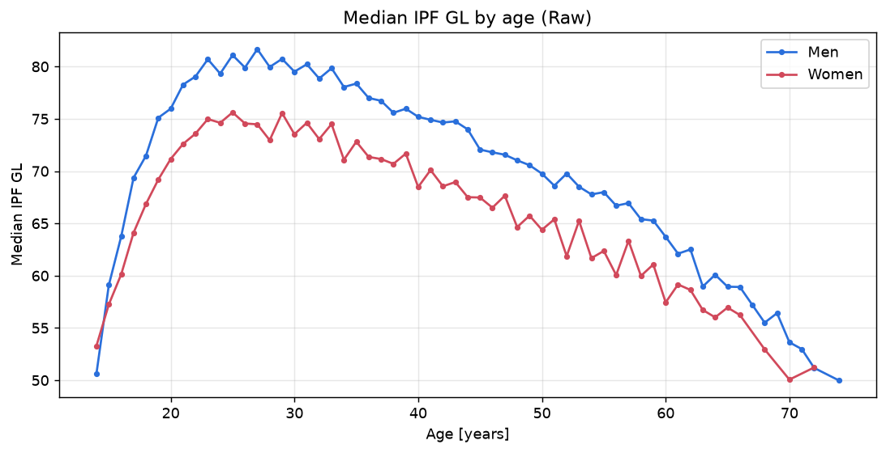
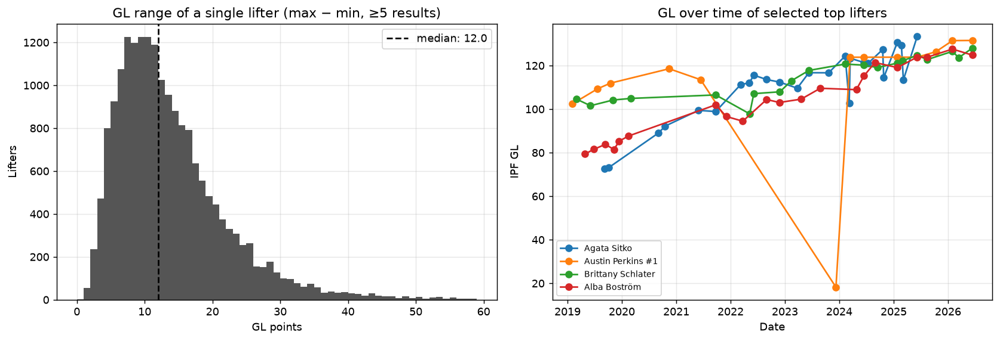

# IPF GL Points: metryka siły względnej w trójboju siłowym

[English version](README.md) · Wersja polska

Przedmiot: Analiza danych sportowych\
Zadanie 2.1: Metryki sportowe – od danych do decyzji

Trójbój siłowy (powerlifting) składa się z trzech bojów: przysiadu ze sztangą, wyciskania leżąc i martwego ciągu.
Zawodnik ma po trzy podejścia w każdym boju, a o wyniku decyduje Total, czyli suma najlepszych zaliczonych
podejść. Zawodnicy rywalizują w kategoriach wagowych, więc potrzebny jest sposób na wskazanie najlepszego zawodnika
ponad podziałem na kategorie. Do tego służy wybrana metryka.

Wszystkie liczby w opracowaniu pochodzą z analizy w notebooku [`analysis.ipynb`](analysis.ipynb)
(kod i wykresy są po angielsku). Analiza obejmuje 408 tys. startów w trójboju z federacji IPF z lat 2019-2026
(baza OpenIPF, stan na 24.10.2026).

## 1. Nazwa i znaczenie

IPF GL Points (*IPF Goodlift Points*) to oficjalna formuła Międzynarodowej Federacji Trójboju Siłowego (IPF),
obowiązująca od 1 maja 2020 r. Zastąpiła używane wcześniej formuły Wilksa i IPF Points.

Metryka mierzy siłę względną, czyli to, jak wynik zawodnika wypada na tle wyniku oczekiwanego od kogoś o tej samej
masie ciała i płci. Wynik podany jest w procentach poziomu mistrzostw świata IPF:

$$
\mathrm{GL} = \frac{100 \cdot \mathrm{Total}}{A - B \cdot e^{-C \cdot \mathrm{BW}}}
$$

Mianownik to oczekiwany Total zawodnika o masie ciała BW na mistrzostwach świata. GL = 100 oznacza wynik na poziomie
typowego uczestnika MŚ, a GL = 80 to 80% tego poziomu.

W przykładzie poniżej (sekcja 2 notebooka) kolejność według kilogramów jest odwrotna niż według GL.

| Zawodnik | Masa ciała | Total | GL | Miejsce wg Total | Miejsce wg GL |
|---|---|---|---|---|---|
| Zawodniczka A | 57 kg | 420 kg | 98,5 | 3 | **1** |
| Zawodnik B | 66 kg | 600 kg | 93,5 | 2 | 3 |
| Zawodnik C | 120 kg | 820 kg | 95,3 | **1** | 2 |

## 2. Dane wejściowe

| Dane | Skąd | Uwagi |
|---|---|---|
| Total [kg] | protokół zawodów | suma najlepszych zaliczonych podejść z 3 bojów; zawodnik, który spalił wszystkie podejścia w jednym boju, nie ma wyniku |
| Masa ciała [kg] | oficjalne ważenie przed zawodami | dokładna masa, a nie kategoria wagowa |
| Płeć | zgłoszenie | osobne współczynniki dla kobiet i mężczyzn |
| Kategoria sprzętowa | zgłoszenie | *Raw / Classic* (bez sprzętu wspomagającego) albo *Equipped* (kostiumy) |
| Rodzaj zawodów | zgłoszenie | trójbój albo samo wyciskanie, każdy z własnym zestawem współczynników |
| Współczynniki A, B, C | regulamin IPF | 8 zestawów, dopasowanych przez IPF do wyników MŚ |

Współczynniki dla trójboju:

| Płeć, sprzęt | A | B | C |
|---|---|---|---|
| Mężczyźni, Raw | 1199,72839 | 1025,18162 | 0,00921 |
| Kobiety, Raw | 610,32796 | 1045,59282 | 0,03048 |
| Mężczyźni, Equipped | 1236,25115 | 1449,21864 | 0,01644 |
| Kobiety, Equipped | 758,63878 | 949,31382 | 0,02435 |

Implementacja jest w [`powerlifting_metrics.py`](powerlifting_metrics.py). Sprawdziłem ją na całej bazie
z kolumną `Goodlift`, którą OpenPowerlifting liczy niezależnie. Największa różnica wynosi 0,005, czyli tyle,
ile daje zaokrąglenie.

## 3. Interpretacja

Normalizacja spełnia swoje zadanie. Korelacja Spearmana między masą ciała a wynikiem spada z +0,56 dla Totalu
do +0,15 dla GL u mężczyzn i z +0,40 do -0,09 u kobiet, więc cięższy zawodnik nie dostaje już wyższego wyniku
tylko dlatego, że jest cięższy.



Punkt odniesienia 100 nie mówi, czy wynik 75 to dużo, czy mało. Mówią to percentyle, tu policzone dla startów Raw
od 2019 r.:

| Wartość GL | Mężczyźni: odsetek startów poniżej | Kobiety: odsetek startów poniżej | Jak to czytać |
|---|---|---|---|
| < 60 | 13,7% | 25,8% | początkujący / bardzo słaby start |
| < 70 | 35,5% | 52,4% | mediana kobiet ≈ 69 |
| < 80 | 66,0% | 77,5% | mediana mężczyzn ≈ 75; 80 to solidny poziom krajowy |
| < 90 | 88,6% | 91,9% | ≥ 90: górne 10%, czołówka krajowa |
| < 100 | 97,6% | 97,8% | ≈ 100: mediana kategorii Open na MŚ IPF (M 99,6; K 98,5) |
| < 110 | 99,7% | 99,5% | ≥ 110: ścisła czołówka światowa (rekord w danych: 131,5) |

Wysokie GL oznacza dużą siłę w stosunku do masy ciała, czyli wynik bliski lub wyższy niż oczekiwany od uczestnika
MŚ w tej samej wadze. Niskie GL może oznaczać brak doświadczenia, ale też nieudany start, kontuzję albo start
„treningowy” (więcej w punkcie 5). GL to skala ilorazowa, w której 10 punktów to 10% poziomu MŚ, więc różnice
między zawodnikami można czytać procentowo, bez przeliczania kilogramów.



## 4. Praktyczne zastosowanie

| Kto | Sytuacja | Jak pomaga GL |
|---|---|---|
| Sędziowie / organizator | wyłonienie „najlepszego zawodnika zawodów” (*Best Lifter*) | jedno porównanie zamiast ośmiu kategorii; IPF używa GL właśnie w tym celu |
| Trener kadry / federacja | powołania na MŚ, przyznanie stypendium, wybór zawodnika do drużyny przy limicie miejsc | porównanie kandydatów z różnych kategorii wagowych |
| Trener i zawodnik | decyzja o zmianie kategorii wagowej (np. zbić 3 kg do niższej czy przytyć do wyższej) | można policzyć, przy jakim Totalu zawodnik ma to samo GL w nowej wadze, i ocenić, czy zmiana się opłaca |
| Zawodnik | śledzenie postępów, gdy zmienia się masa ciała | wzrost Totalu przy wzroście masy ciała nie zawsze jest postępem; GL to pokazuje |
| Analityk | porównania między latami, krajami, klubami | jedna skala dla całej populacji (np. „ilu naszych zawodników ma GL > 90?”) |

Lider rankingu GL wśród mężczyzn, Austin Perkins (891,5 kg przy 73,3 kg masy ciała, GL 131,5), jest dopiero 217.
według samego Totalu. Żaden z 10 najlepszych zawodników według GL nie mieści się w top 10 według Totalu.

## 5. Ograniczenia: dlaczego sama wartość metryki nie wystarczy

Każde z poniższych ograniczeń sprawdziłem na danych (sekcje 2 i 6 notebooka).

### a) Wzór działa tylko w zakresie, do którego go dopasowano

Współczynniki dopasowano do wyników dorosłych zawodników na MŚ. U kobiet mianownik spada do zera przy masie ciała
17,7 kg, a w bazie jest start 7-letniej zawodniczki ważącej 18 kg, której Total 117,5 kg daje GL = 1304.
U mężczyzn działa to odwrotnie: wzór zaniża wyniki bardzo lekkich zawodników.

### b) Kategorie wagowe nie są idealnie wyrównane

Wśród mężczyzn średnie GL 10 najlepszych zawodników wynosi 107,4 w kategorii 59 kg i 119,8 w kategorii 93 kg.
Najlżejsi i najciężsi (120+) wypadają o 5-6% poniżej średniej, a kategorie 74-93 kg o 4% powyżej. W tym teście
starszy Wilks wypada dla mężczyzn równiej (rozrzut 1,2% wobec 4,4% dla GL), a dla kobiet najrówniej wypada GL
(2,0%). Część różnic wynika z liczebności kategorii: w kategorii 83 kg startowało 29 tys. zawodników, a w 59 kg
4,4 tys., i czołówka wybrana z większej grupy jest mocniejsza. To, czy metryka jest „sprawiedliwa”, zależy więc
od tego, jak tę sprawiedliwość mierzymy.



### c) Metryka nie uwzględnia wieku

Mediana GL osiąga szczyt w wieku 25-27 lat (M 81,7; K 75,6), a u 18-latków jest o 9-10 punktów niższa,
u 60-latków o 18 punktów niższa. Junior z GL 85 może mieć większy potencjał niż 28-latek z GL 90, czego samo GL
nie pokaże.



### d) Sprzęt nadal ma znaczenie

GL ma osobne współczynniki dla startów w kostiumach, więc teoretycznie wyniki są porównywalne. Jednak
8,5 tys. zawodników, którzy startowali w obu kategoriach, ma w sprzęcie medianę GL o 6,4 punktu niższą niż bez
sprzętu, a rozrzut jest duży (od -18 do +6 dla 80% osób).

### e) Pojedynczy start to nie cała prawda

U zawodników z co najmniej 5 startami różnica między najlepszym a najgorszym GL wynosi w medianie 12 punktów,
a u co dziesiątego przekracza 24. Na wynik wpływają forma, zbijanie wagi, spalone podejścia i cel startu. Lider
rankingu ma w grudniu 2023 r. start z sumą 125 kg (25 / 25 / 75 kg, GL ≈ 18). To symboliczny wynik, około jednej
siódmej rekordu tego zawodnika, a metryka liczy go tak samo jak każdy inny start.



### f) Jedna liczba ukrywa profil zawodnika

GL patrzy tylko na sumę. Wśród 10 najlepszych zawodników udział przysiadu w Totalu waha się od 33% do 38%,
a martwego ciągu od 37,5% do 42%. Trener, który planuje trening albo dobór podejść, potrzebuje tego podziału,
a GL go nie przenosi.

### g) Jakość danych

Ten sam start bywa zapisany kilka razy (zawodnik startujący jednocześnie jako junior i w kategorii Open), a w bazie
są starty dzieci. Bez oczyszczenia danych mediany i liczby startów wychodzą błędne: przed usunięciem duplikatów
jeden z czołowych zawodników spadał w rankingu mediany z 2. na 203. miejsce.

### h) Wybór formuły zmienia czołówkę rankingu

GL, DOTS i Wilks są skorelowane prawie idealnie (Spearman 0,99), ale ich listy top 10 pokrywają się tylko
w 60-90%. Różnice dotyczą czołówki, w której rozstrzygają się medale i miejsca w kadrze.

## Сzy na podstawie jednej metryki można jednoznacznie stwierdzić, który zawodnik jest lepszy?

Nie. Jedna metryka porządkuje wyniki według jednego, z góry wybranego kryterium, a trzy rzeczy sprawiają, że takie
uporządkowanie nie rozstrzyga, kto jest lepszy.

Po pierwsze, liczba zależy od decyzji podjętych przed jej policzeniem: wyboru formuły (GL, DOTS, Wilks albo sam
Total), sposobu agregacji (rekord, mediana, ostatni start) i zakresu danych (okres, federacja, sprzęt). Każdy z tych
wyborów zmienia ranking. Top 10 według Totalu i top 10 według GL nie mają ani jednego wspólnego zawodnika.

Po drugie, ta sama metryka może wskazać różnych zawodników. Przykład z danych (sekcja 7 notebooka):

| Zawodnik | Starty | Najlepsze GL | Miejsce | Mediana GL | Miejsce |
|---|---|---|---|---|---|
| Ade Omisakin | 18 | **122,5** | **5** | 109,3 | 55 |
| Russel Orhii | 10 | 120,9 | 13 | **117,0** | **3** |

Według rekordu lepszy jest Omisakin, a według typowego wyniku Orhii. Spotkali się dwa razy, na MŚ 2021
(GL 116,7 vs 103,9) i w Sheffield 2025 (120,6 vs 118,0), i oba razy wygrał Orhii. Trener, który szuka zawodnika
zdolnego do wyniku życia, wybierze Omisakina, a trener, któremu zależy na pewnym, wysokim wyniku w dniu zawodów,
wybierze Orhiiego.

Po trzecie, metryka mierzy tylko to, co do niej włożono. GL nie uwzględnia wieku, potencjału rozwoju, stabilności
formy, profilu bojów, historii kontuzji ani celu startu, a do tego ma obciążenia opisane w punkcie 5: nierówne
kategorie wagowe, ograniczony zakres stosowalności wzoru i zależność od sprzętu.

Metryka taka jak IPF GL dobrze sprawdza się przy zawężaniu wyboru i obiektywnym porównywaniu wyników
w ustalonych warunkach i w ten sposób używa jej IPF. Prawidłowa ocena zawodnika wymaga jednak kilku metryk
(rekord, regularność, trend, wiek), kontekstu startów i wiedzy trenera.

## Struktura repozytorium

```
├── README.md                     ← opracowanie po angielsku
├── README.pl.md                  ← opracowanie po polsku (ten plik)
├── analysis.ipynb                ← analiza na danych, wykonany notebook z wynikami
├── powerlifting_metrics.py       ← implementacja IPF GL + wczytywanie danych
├── pyproject.toml, uv.lock       ← zależności (zarządzane przez uv)
├── scripts/make_sample.py        ← generuje próbkę danych do repozytorium
├── data/sample/                  ← próbka: starty SBD od 2024 r. (~180 tys. wierszy, 6,7 MB)
├── data/raw/                     ← pełna baza (pobierana automatycznie, poza gitem)
└── figures/                      ← wykresy użyte w opracowaniu
```

## Uruchomienie

Projekt używa [uv](https://docs.astral.sh/uv/):

```bash
uv sync
uv run jupyter notebook analysis.ipynb
```

Przy `USE_SAMPLE = False` (domyślnie) notebook przy pierwszym uruchomieniu pobiera pełną bazę OpenIPF (~70 MB)
do `data/raw/`. Liczby w tym opracowaniu pochodzą z tego wariantu. Przy `USE_SAMPLE = True` korzysta z próbki
z repozytorium i działa bez internetu; liczby będą trochę inne, bo próbka obejmuje tylko lata 2024-2026.

## Źródła

- OpenPowerlifting / OpenIPF: dane (domena publiczna), https://www.openpowerlifting.org/, https://www.openipf.org/
- Opis formuły i kolumn danych: README dystrybucji danych OpenPowerlifting, https://gitlab.com/openpowerlifting/opl-data/-/blob/main/docs/data-readme.md
- Implementacja referencyjna współczynników GL: https://gitlab.com/openpowerlifting/opl-data/-/blob/main/crates/coefficients/src/goodlift.rs
- International Powerlifting Federation: regulamin techniczny i formuła IPF GL Points, https://www.powerlifting.sport/
