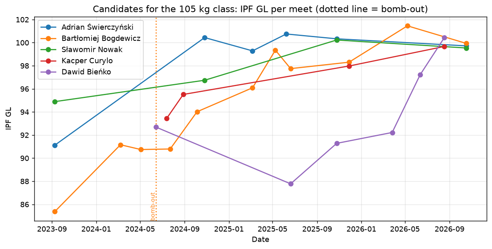
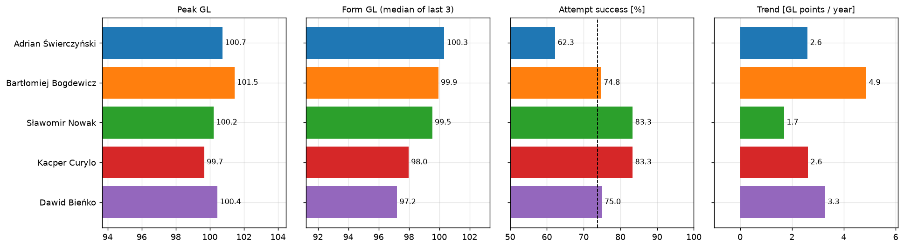

Przedmiot: Analiza danych sportowych\
Zadanie 2.2: Od pomysłu do analizy – metryki sportowe w praktyce (wariant A)\
Repozytorium z analizą: <https://github.com/archeq/powerlifting-relative-strength>

To zadanie rozwija poprzednie (2.1), w którym opisałem metrykę IPF GL Points w trójboju siłowym i pokazałem,
że jedna liczba nie rozstrzyga, który zawodnik jest lepszy. Tutaj stosuję kilka metryk naraz do konkretnej decyzji.

## 1. Problem analityczny

Polski związek (PZKFiTS) ma jedno miejsce w kategorii mężczyzn do 105 kg na mistrzostwach świata IPF w trójboju
klasycznym. Którego z aktywnych polskich zawodników tej kategorii powinien wysłać?

Wybrałem kategorię 105 kg, bo pięciu najlepszych kandydatów ma rekordy GL w przedziale zaledwie 99,7-101,5.
Sam rekord nie wystarczy więc do wyboru i trzeba sięgnąć po inne metryki.

## 2. Wybór metryk

| Metryka | Jak liczona | Dlaczego ją wybrałem |
|---|---|---|
| Szczyt | najlepsze GL od 2023 r. | pokazuje, na co zawodnika stać w najlepszy dzień |
| Forma | mediana GL z 3 ostatnich ważnych startów | pokazuje, czego można się spodziewać teraz w typowy dzień; mediana jest odporna na jeden słabszy start |
| Skuteczność podejść | zaliczone podejścia / wykonane podejścia (maks. 9 na zawody) | na MŚ każde spalone podejście kosztuje miejsca, a trzy spalone w jednym boju oznaczają brak wyniku |
| Trend | nachylenie prostej dopasowanej do GL w czasie (punkty GL na rok) | MŚ są za kilka miesięcy, więc liczy się też kierunek zmian formy |

Wszystkie metryki wynikowe opierają się na IPF GL (z zadania 2.1), dzięki czemu można porównywać starty
przy różnej masie ciała. Dodatkowo zestawiłem bezpośrednie starcia kandydatów na tych samych zawodach.

## 3. Dane

Dane są rzeczywiste: wszystkie starty polskich zawodników w trójboju klasycznym od 2023 r. z bazy OpenIPF
(zawody krajowe PZKFiTS, europejskie EPF i światowe IPF), łącznie z pojedynczymi podejściami i startami
zakończonymi bez wyniku. To 4805 startów 2282 zawodników.

Kandydatem jest zawodnik, który:

- startował przynajmniej raz w kategorii 105 kg od 2023 r.,
- ma co najmniej 4 ważne wyniki od 2023 r.,
- startował w ostatnich 12 miesiącach.

Spośród spełniających te warunki wziąłem pięciu z najwyższym GL. Same kryteria też są decyzją: zawodnik
z najwyższym GL w kategorii (102,5) ma tylko 3 ważne starty i odpada, a jeden z mocnych zawodników nie startował
od października 2024 r.

## 4. Obliczenia

| Zawodnik | Starty | Bez wyniku | Szczyt GL | Forma GL | Skuteczność podejść | Trend GL/rok | Wiek |
|----------------|----|------|-----|-----|------|------|---|
| Adrian Świerczyński | 6 | 0 | 100,7 | **100,3** | 62,3% | 2,6 | 30 |
| Bartłomiej Bogdewicz | 12 | 1 | **101,5** | 99,9 | 74,8% | **4,9** | 23 |
| Sławomir Nowak | 4 | 0 | 100,2 | 99,5 | **83,3%** | 1,7 | 28 |
| Kacper Curylo | 4 | 0 | 99,7 | 98,0 | **83,3%** | 2,6 | 22 |
| Dawid Bieńko | 6 | 0 | 100,4 | 97,2 | 75,0% | 3,3 | 21 |

Średnia skuteczność podejść wszystkich Polaków w tych danych wynosi 73,7%.

Miejsca według poszczególnych metryk (1 = najlepszy):

| Zawodnik | Szczyt | Forma | Skuteczność | Trend |
|---|---|---|---|---|
| Świerczyński | 2 | **1** | 5 | 4 |
| Bogdewicz | **1** | 2 | 4 | **1** |
| Nowak | 4 | 3 | **1** | 5 |
| Curylo | 5 | 4 | **1** | 3 |
| Bieńko | 3 | 5 | 3 | 2 |

{width=88%}

{width=100%}

Skuteczność w poszczególnych bojach:

| Zawodnik | Przysiad | Wyciskanie | Martwy ciąg |
|---|---|---|---|
| Świerczyński | 55,6% | 52,9% | 77,8% |
| Bogdewicz | 80,0% | 66,7% | 77,8% |
| Nowak | 91,7% | 83,3% | 75,0% |
| Curylo | 91,7% | 83,3% | 75,0% |
| Bieńko | 82,4% | 77,8% | 64,7% |

Bezpośrednie starcia (wygrane według GL na tych samych zawodach, wiersz pokonał kolumnę):

| | Świerczyński | Bogdewicz | Nowak | Curylo | Bieńko |
|---|---|---|---|---|---|
| Świerczyński | | 2 | 3 | 0 | 1 |
| Bogdewicz | 1 | | 1 | 1 | 1 |
| Nowak | 1 | 1 | | 0 | 1 |
| Curylo | 0 | 0 | 0 | | 0 |
| Bieńko | 0 | 1 | 0 | 1 | |

## 5. Interpretacja

Metryki nie prowadzą do tych samych wniosków. Każda z nich wskazuje innego lidera.

Szczyt prawie niczego nie rozstrzyga. Pięciu zawodników mieści się w 1,8 punktu GL, czyli kilkunastu kilogramach
sumy, a w zadaniu 2.1 pokazałem, że wyniki jednego zawodnika na różnych zawodach różnią się zwykle o kilkanaście
punktów.

Forma wskazuje Świerczyńskiego (100,3), ale Bogdewicz (99,9) i Nowak (99,5) są tuż za nim. Różnica 0,8 punktu
to około 6 kg w sumie trójboju.

Skuteczność podejść odwraca kolejność. Świerczyński zalicza tylko 62% podejść, wyraźnie poniżej średniej
polskich zawodników (74%). W przysiadzie sześć razy próbował 300 kg i nie zaliczył żadnej z tych prób. Mimo to
trzy razy wygrał zawody krajowe, bo jego pewne podejścia wystarczały, ale na MŚ taki margines może nie wystarczyć.
Najpewniej startują Nowak i Curylo (83%).

Trend najmocniej przemawia za Bogdewiczem: +4,9 punktu GL rocznie, z 85 w 2023 r. do 98-101 w ostatnim roku.
Świerczyński od jesieni 2024 r. utrzymuje stały poziom około 100, a jego dodatni trend wynika głównie ze słabszego
startu w 2023 r.

Bezpośrednie starcia przemawiają za Świerczyńskim (6 wygranych, 2 porażki), ale z Bogdewiczem spotkał się tylko
trzy razy (2-1), a w ostatnim starciu, na Mistrzostwach Polski w październiku 2026 r., wyżej był Bogdewicz.

Zastosowanie kilku metryk pokazało więc coś, czego nie widać w samym rekordzie: zawodnicy o niemal identycznym
poziomie różnią się ryzykiem i kierunkiem rozwoju, a o wyborze decyduje to, które z tych cech trener uzna za ważniejsze.

## 6. Rekomendacja

Rekomenduję wysłanie Bartłomieja Bogdewicza, a Adriana Świerczyńskiego jako rezerwowego. Uzasadnienie:

- poziom obu zawodników jest praktycznie równy (forma 99,9 i 100,3; różnica mniejsza niż typowe wahania między startami),
- decyzja dotyczy przyszłych mistrzostw, a Bogdewicz jako jedyny z czołowej trójki wyraźnie się rozwija,
- ma najwyższy szczyt, najwięcej startów (12, więc jego wyniki są najlepiej udokumentowane) i wygrał ostatnie bezpośrednie starcie,
- jego skuteczność podejść (75%) odpowiada średniej, a skuteczność Świerczyńskiego (62%) jest od niej wyraźnie niższa.

Wnioski praktyczne dla trenerów:

- Bogdewicz w 4 z 12 startów spalił pierwsze podejście w wyciskaniu, a jedyny start bez wyniku (2024 r.) to trzy
  spalone podejścia właśnie w wyciskaniu. Przed MŚ warto ustalić ostrożniejsze pierwsze podejście w tym boju.
- Świerczyński traci wynik na zbyt ambitnych podejściach w przysiadzie. Gdyby zamiast ataku na 300 kg wybierał
  mniejsze skoki, jego suma mogłaby być wyższa niż obecnie.
- Gdyby związek stawiał przede wszystkim na pewny wynik bez ryzyka spalenia, rozsądnym wyborem byłby Nowak:
  ma najwyższą skuteczność wśród zawodników z czołowej trójki i ani jednego startu bez wyniku.

## 7. Ograniczenia analizy

- Mała liczba startów: Nowak i Curylo mają po 4 wyniki, więc ich mediana i trend mogą się łatwo zmienić po jednym starcie.
- Trend liczony prostą linią przez cały okres może mylić. U Świerczyńskiego daje +2,6 punktu rocznie, choć od dwóch lat jego poziom stoi w miejscu.
- Starty mają różną rangę. Wyniki z MŚ, mistrzostw Europy i zawodów krajowych liczą się tak samo, choć cel i presja startu są inne.
- Skuteczność podejść zależy od taktyki. Zawodnik walczący o medal może celowo ryzykować, więc niska skuteczność nie zawsze oznacza słabość.
- Wynik zależy od przyjętych kryteriów: przy progu 3 startów zamiast 4 kandydatem byłby zawodnik z najwyższym GL w kategorii (102,5).
- Dane nie zawierają informacji o kontuzjach, przygotowaniu do konkretnych zawodów ani o tym, czy zawodnik w ogóle jest dostępny w terminie MŚ.

## Źródła

- OpenPowerlifting / OpenIPF: dane (domena publiczna), <https://www.openipf.org/>
- International Powerlifting Federation: formuła IPF GL Points, <https://www.powerlifting.sport/>
- Obliczenia: notebook `team_selection.ipynb` w repozytorium
